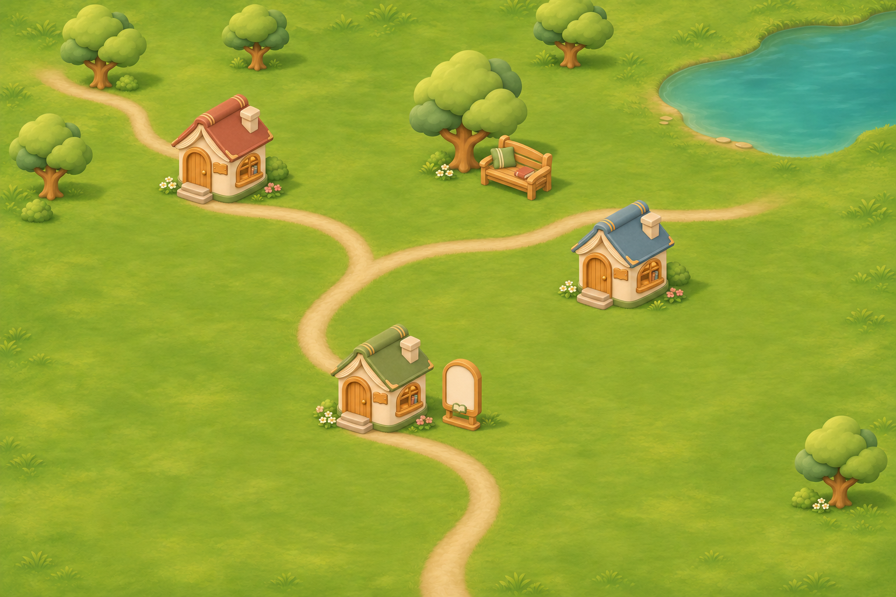

# TEXTOPIA 독서마을 2.5D 에셋 v02

책 한 권을 하나의 집으로 표현하는 개인 독서마을용 이미지입니다. 집 사이에 충분한 여백을 두고, 책집과 문장 전시대를 통해 독서 취향을 보여주는 구성을 제안합니다.

2026-11-07 생성. 고정 시점의 PNG 레이어용이며, 앱 화면 연결은 별도 작업입니다.

## 배치 참고



이 이미지는 분위기와 배치 방향을 확인하는 생성형 시안입니다. `assets.json`의 좌표로 원본을 합성한 결과와 픽셀 단위로 일치하지 않습니다. 개별 집 클릭이나 꾸미기에는 아래 바닥 맵과 투명 PNG를 사용합니다.

## 파일 구성

| 경로 | 내용 |
| --- | --- |
| `maps/map-ground.png` | 잔디·길·연못으로 구성한 바닥 맵, 1536 × 1024 |
| `sprites/houses/book-house-sage.png` | 초록 책집 |
| `sprites/houses/book-house-terracotta.png` | 테라코타 책집 |
| `sprites/houses/book-house-blue.png` | 파랑 책집 |
| `sprites/props/sentence-frame.png` | 문장을 전시하는 빈 패널 |
| `sprites/props/reading-bench.png` | 독서 벤치 |
| `sprites/nature/reading-tree.png` | 둥근 독서 나무 |
| `sprites/nature/garden-shrub.png` | 관목 |
| `sprites/nature/flower-patch.png` | 꽃 무리 |
| `previews/map-arrangement-reference.png` | 배치 참고 이미지, 1536 × 1024 |
| `assets.json` | 이미지 크기, 투명 영역 경계, 기준점, 표시 크기, 배치 예시 |
| `generation-prompts.json` | 생성 도구와 전체 프롬프트 |

모든 PNG 원본을 크롭·리사이즈 없이 보존했습니다. 스프라이트 8종은 투명 알파 채널이 있는 RGBA 이미지입니다. 벤치는 1312 × 1199, 나머지 스프라이트는 1254 × 1254입니다.

## 앱에서 참조하기

정적 파일 루트가 `textopia/public`이면 기본 경로는 `/assets/village/v02/`입니다.

- 맵: `/assets/village/v02/maps/map-ground.png`
- 배치 정보: `/assets/village/v02/assets.json`
- 초록 책집: `/assets/village/v02/sprites/houses/book-house-sage.png`

`assets.json` 안의 `file`과 `arrangement_reference`는 **이 폴더를 기준으로 한 상대 경로**입니다. 앱 페이지의 현재 URL에 바로 붙이지 않고 위 기본 경로를 붙여 사용합니다.

## 배치 규칙

1. `map-ground.png`를 바닥 레이어로 놓습니다. 이 맵은 반복 타일이 아닌 단일 배경입니다.
2. `placements`의 좌표는 1536 × 1024 맵 기준 픽셀입니다. `(x, y)`는 각 오브젝트의 권장 아래 중앙 기준점입니다.
3. `suggestedCanvasWidth`를 이미지 전체 표시 너비로 사용합니다. 투명 여백도 포함하며, 높이는 원본 종횡비를 유지합니다.
4. `anchorNormalized`를 이용해 이미지의 왼쪽 위 위치를 계산합니다.

```text
표시 높이 = 표시 너비 × sourceSize[1] / sourceSize[0]
drawX = x - anchorNormalized[0] × 표시 너비
drawY = y - anchorNormalized[1] × 표시 높이
```

`visibleWidth`가 있는 배치 항목은 기본 너비를 덮어씁니다. 투명 여백을 제외한 표시 너비이므로 다음처럼 변환합니다.

```text
표시 너비 = visibleWidth × sourceSize[0] / (alphaBounds[2] - alphaBounds[0])
```

`alphaBounds`는 알파 값 32 이상 영역의 `[left, top, right, bottom]`입니다. 오른쪽·아래 경계는 포함하지 않습니다. `anchorNormalized`는 이 경계 상자의 아래 중앙에서 계산한 권장값이며, 실제 발밑 위치는 화면에서 조정할 수 있습니다.

오브젝트는 기준점 `y`가 작은 것부터 그리면 아래쪽 오브젝트가 앞에 보입니다. 화면 크기를 변경할 때는 배경, 좌표, 표시 크기를 같은 비율로 조절합니다. 예시 좌표는 시작안이며 화면 가장자리의 잘림과 겹침은 실제 화면에서 확인합니다.

문장 전시대는 글 없는 이미지입니다. 문장·책 제목은 실제 텍스트나 클릭 후 열리는 읽기 화면으로 표시하면 읽기와 수정이 쉽습니다.

## 시각 기준과 생성 정보

- 목표 시점: 수평 방향 45도, 지면 위 35도의 고정 사선 조감도.
- 색과 재질: 따뜻한 아이보리, 세이지 그린, 테라코타, 탁한 파랑, 부드러운 무광 표면.
- 조명: 왼쪽 위. 에셋을 뒤집거나 회전하면 조명 방향도 달라집니다.
- 생성 도구: 내장 `image_gen`. 생성형 이미지이므로 수치가 보장된 3D 렌더 패스는 아닙니다.
- 이 묶음에는 3D 모델과 회전용 시점별 이미지가 포함되지 않습니다.

수정할 때는 원본을 덮어쓰기보다 새 버전 폴더에 추가하고 해당 버전의 메타데이터와 사용 안내를 함께 갱신합니다.
